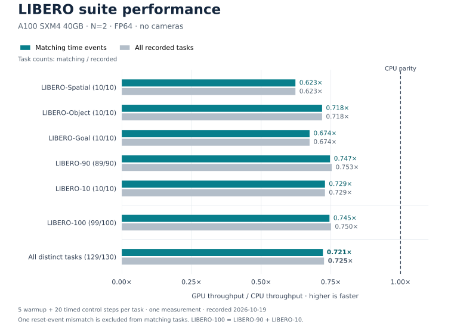

<div align="center">

# GPU-LIBERO

### GPU Simulation for Lifelong Robot Learning

[LIBERO](https://github.com/Lifelong-Robot-Learning/LIBERO) · [Project Website](https://libero-project.github.io/) · [LIBERO Paper](https://arxiv.org/abs/2306.03310) · [LIBERO Documentation](https://lifelong-robot-learning.github.io/LIBERO/)

</div>

**Performance status:** In the recorded N=2, no-camera benchmark, GPU throughput
is **0.721× CPU throughput** across 129 tasks with matching time events.
See [performance results](#performance) for the suite breakdown and measurement scope.

**GPU-LIBERO** adds GPU physics to [LIBERO](https://github.com/Lifelong-Robot-Learning/LIBERO), a benchmark for knowledge transfer in multitask and lifelong robot learning. Install this distribution and keep your existing LIBERO environment code: simulation uses the GPU by default.

- Original LIBERO imports, task definitions, environment interfaces, and benchmark suites.
- 130 manipulation tasks across **LIBERO-Spatial**, **LIBERO-Object**, **LIBERO-Goal**, and **LIBERO-100**, including the **LIBERO-90 / LIBERO-10** split.
- Native FP64 CUDA physics with cuBLASDx / cuSOLVERDx, and an upstream MJWarp FP32 fast path.
- Existing observation, rendering, controller, state, and vector-environment interfaces.
- LIBERO policy architectures, lifelong learning methods, and dataset tools.

The [MJWarp FP32 backend](libero/libero/gpu/host/backends/mjwarp/README.md)
uses upstream physics with the existing GPU OSC and observation pipeline.
It requires an isolated newer-MuJoCo environment and explicit offline
preparation. Automatic routing selects MJWarp for FP32 and native CUDA for
FP64; FP64 remains the default precision. The handwritten FP32 backend is
available with `physics_engine="native"`. The performance table
below describes the recorded native FP64 implementation.

## Contents

- [Performance](#performance)
- [Installation](#installation)
- [Getting Started](#getting-started)
- [Datasets](#datasets)
- [Training](#training)
- [Evaluation](#evaluation)
- [Configuration](#configuration)
- [Tests](#tests)
- [Contributing](#contributing)
- [Acknowledgments](#acknowledgments)
- [License](#license)

## Performance

Recorded on **2026-10-19**, using an **NVIDIA A100 SXM4 40GB**, **N=2**, FP64
physics/state, and **no cameras**. Each task used 5 warmup control steps followed
by 20 continuously timed control steps, measured once. GPU execution used the
explicit single-physical-substep CUDA fusion and an outer control-step graph.
CPU execution used MuJoCo 2.3.7 with two `SubprocVectorEnv` workers on distinct
physical cores and one BLAS thread per worker.



**Speedup = GPU throughput / CPU throughput.** Suite values are calculated from
summed elapsed times for equal work: `sum(CPU seconds) / sum(GPU seconds)`.
Values above 1× favor GPU; values below 1× favor CPU.

| Task suite | Matching / recorded tasks | Matching time events | All recorded tasks |
| --- | ---: | ---: | ---: |
| LIBERO-Spatial | 10 / 10 | 0.623× | 0.623× |
| LIBERO-Object | 10 / 10 | 0.718× | 0.718× |
| LIBERO-Goal | 10 / 10 | 0.674× | 0.674× |
| LIBERO-90 | 89 / 90 | 0.747× | 0.753× |
| LIBERO-10 | 10 / 10 | 0.729× | 0.729× |
| LIBERO-100 (90 + 10) | 99 / 100 | 0.745× | 0.750× |
| **All distinct tasks** | **129 / 130** | **0.721×** | **0.725×** |

LIBERO-100 combines the measured LIBERO-90 and LIBERO-10 tasks; it does not add
another 100 measurements to the distinct-task total. One LIBERO-90 task
(zero-based ID 85) had a pre-existing CPU/GPU reset/time-event difference. The
matching-events column excludes it; the all-recorded column preserves its timing.
The matching subset averages **44.97 CPU versus 32.44 GPU environment steps/s**.

Throughput counts control steps summed over both worlds. A standard control step
contains 25 physical substeps; the throughput is not multiplied by 25.
Environment creation, reset, graph preparation and compilation are excluded.
The recorded build used Release (`-O3 -DNDEBUG`) with `FLASH_FAST_COMPILE=ON`
(`--Ofast-compile=min` for major CUDA units); runtime compilation was disabled.
These are saved benchmark results, not a new measurement after documentation changes.

[Aggregate CSV](media/benchmarks/suite-throughput.csv) ·
[Measurement provenance](media/benchmarks/provenance.json).
Regenerate the figure with `python tools/plot_suite_speedup.py`.

## Installation

### Requirements

- Python **3.10 or newer**.
- An NVIDIA GPU, NVIDIA driver, and CUDA Toolkit with `nvcc` available.
- CMake **3.24 or newer**, Ninja, and a C/C++ compiler for native dependencies.
- NVIDIA MathDx. If no installation is configured, the runtime downloads its pinned **25.12.1 CUDA12** package on first use.

The single-substep build's default local MathDx prelink requires **NVCC 13.2 or
newer**. Older toolchains require the explicit whole-program device-LTO build
configuration; see the [GPU build guide](libero/libero/gpu/README.md).

From the repository root:

```bash
python -m venv .venv
source .venv/bin/activate
python -m pip install --upgrade pip
python -m pip install 'cmake>=3.24,<4' ninja
python -m pip install .
```

For an editable installation, replace the last command with `python -m pip install -e .`.

This distribution installs the `libero` package. Use an environment containing this installation when running your LIBERO code.

### Task resources

Task BDDL files and scene/object XML definitions are included. Meshes, textures, initial states, and demonstration datasets are stored separately. Existing LIBERO resource configurations continue to work; missing default assets and initial states are fetched into the resource cache.

To prepare assets and initial states before creating an environment:

```bash
python -m libero.libero.resource_cli assets init_states
```

Prepare the complete GPU project once before creating GPU batches:

```bash
python -m libero.gpu.build --num-envs 8 --jobs 3
```

The build enumerates all 130 shipped tasks, materializes their model and template
instances, and compiles missing CUDA/Warp products into one project. LIBERO-100
reuses the existing 90-task and 10-task sets. Matching products are shared across
tasks. The generated [parameter table](libero/libero/gpu/data/libero_task_parameters.json)
records every task and the 13 distinct Newton dimension pairs.

## Getting Started

Use the same task and environment imports as upstream LIBERO. No GPU backend argument or factory registration is required.

```python
import os

from libero.libero import benchmark, get_libero_path
from libero.libero.envs import OffScreenRenderEnv

benchmark_dict = benchmark.get_benchmark_dict()
task_suite = benchmark_dict["libero_spatial"]()
task_id = 0
task = task_suite.get_task(task_id)

task_bddl_file = os.path.join(
    get_libero_path("bddl_files"), task.problem_folder, task.bddl_file
)
print(task.language)

env = OffScreenRenderEnv(
    bddl_file_name=task_bddl_file,
    camera_heights=128,
    camera_widths=128,
)
try:
    env.seed(0)
    obs = env.reset()
    init_states = task_suite.get_task_init_states(task_id)
    obs = env.set_init_state(init_states[0])

    for _ in range(10):
        obs, reward, done, info = env.step([0.0] * 7)
finally:
    env.close()
```

Available suite names include `libero_spatial`, `libero_object`, `libero_goal`, `libero_90`, and `libero_10`. LIBERO uses sparse task-completion rewards.

### Native GPU batches

An optional `precision="fp32"` batch configuration shares the maintained
algorithm sources with FP64. Select precision before importing typed physics
modules and prepare its products offline. Precision is fixed per process; both
products can coexist in the same CMake build. See the
[precision guide](libero/libero/gpu/PRECISION.md) for selection, storage,
validation and current scope. The benchmark results above remain FP64.

Use `GpuBatchEnv` to advance multiple worlds of **one task and one shared static
model** in a native GPU batch. This is separate from the compatible
`DummyVectorEnv` / `SubprocVectorEnv` interfaces.

```python
import numpy as np
from libero.libero import benchmark
from libero.libero.envs import GpuBatchEnv

suite = benchmark.get_benchmark("libero_10")()
with GpuBatchEnv(
    suite.get_task_bddl_file_path(0),
    num_envs=8,
    init_states=suite.get_task_init_states(0),
    seed=0,
    use_camera_obs=False,
) as env:
    obs = env.reset()
    obs, rewards, successes, infos = env.step(np.zeros((8, env.action_dim)))
    env.reset(id=[0, 3])
    print(env.diagnostics())
```

Observations are dictionaries with a leading environment axis. `step` advances
all worlds; `reset` and `set_init_state` accept selected IDs in caller order.
There is no automatic reset. `set_init_state` preserves controller history,
whereas `reset` clears episode/controller/observation state. Fixture poses are
sampled once at construction and shared; reset selects movable/robot states
from the supplied bank. If no bank is supplied, the corresponding official
`.pruned_init` file is loaded. Different fixture layouts or tasks require
separate batches. Model replacement and interactive rendering are not exposed
through this entry. Set `use_camera_obs=True` for offscreen images; image rendering
and task goal evaluation are still performed at the host boundary.
This entry retains the low-level physics factory's diagnostic construction mode.
Full-capacity Newton input snapshots (`entry_witness`) are disabled by default:
normal execution allocates no witness buffers and launches no witness copies.
`GpuBatchEnv(..., debug=False)` also disables recovery event recording and the
diagnostic prefix comparisons and cache snapshots. The immutable-model fast path
retains its qualified epoch-based position reuse. It captures
one complete control step when needed and replays that CUDA graph, avoiding
Python source/binding validation on every physical substep. Host boundary status
packets and per-step numerical verification are disabled. `debug=True` enables
these diagnostics and uses the original Python substep path. Cold construction
validation and the physical solver's control flow, convergence and warning/reset
behavior still apply. The dedicated quality recorder also enables input snapshots.
In the default fast profile, collision processing also skips inactive-output
backup copies and computes contact parameters only for live queries and kept
contacts. `debug=True` retains the full-capacity collision diagnostics. Contact
ordering, configured capacities and overflow/error handling are unchanged.
Set `strict_build_receipts=True` to additionally use the product entry's full
compiler/library dependency receipts and artifact cache; this can add substantial
cold-build time. This option does not change `debug` or grant numerical qualification.

For source ownership, ordinary versus explicitly fused graphs, and retained
fallback paths, see the [runtime architecture index](libero/libero/gpu/ARCHITECTURE.md).
For N=2 endpoint checks and single-measurement CPU/GPU comparisons, use the
[stable validation tools](tools/validation/README.md). Historical experiment
drivers and their evidence belong in the external development workspace.

Batch execution loads a completed offline build, by default from
`~/.cache/libero-gpu/project` (or `$LIBERO_GPU_CACHE_DIR/project`). Set `build_root`
to choose another directory, using the same value for `libero.gpu.build`.
Prepared native scene models and generated constraint/Newton sources are loaded
from the instance catalog. Runtime buffers, graphs and owner bindings are created
for each environment. Missing native or Warp products raise an error before
compilation; normal batch execution does not run NVCC or NVRTC builds.
Changes to source or the requested build profile require an offline build.
`allow_compile=True` is an explicit developer option used by the offline builder.
The default profile uses Panda/OSC_POSE, seed 0, N=8 and the standard camera setup.

Device memory is budgeted from the selected GPU's **current free memory** during
construction, after existing physics allocations. The planner reserves an
estimate for subsequent solver/controller/observation allocations plus the
larger of 512 MiB or 10% of the available budget as headroom. An optional `memory_budget`
dictionary accepts `limit_bytes`, `reserve_bytes`, and `safety_fraction`; the
limit applies to allocations remaining at the planning boundary. The snapshot
is available in `env.memory_budget`. These are estimates, so subsequent CUDA
allocation failures remain possible. Index, model, contact, and kernel resource
checks remain enforced. Insufficient memory raises an error without changing N
or truncating contacts.

After the unified build, verify a prepared task without resetting or advancing it:

```bash
python -m benchmark_scripts.benchmark_gpu_batch --suite libero_10 --num-envs 8 --task-ids 0 --build-only --output results/build.json
```

The report records the project directory and actual compiler calls. This
mode still creates CUDA owners and records graphs, but executes no control steps.
`GpuBatchEnv(..., initialize=False)` provides the same preparation boundary;
call `reset()` before stepping it.

To time the complete batch interface, excluding setup, reset, and policy inference:

```bash
python -m benchmark_scripts.benchmark_gpu_batch --suite libero_10 --num-envs 8 --warmup 20 --steps 600 --repeats 1
# Add --camera for two 128x128 RGB cameras, or --task-ids 0 for one task.
```

Use the same `--build-root` for preparation and timing if specifying one.
The JSON report includes the build cache and compiler calls, setup time, milliseconds per batch control
step, environment steps per second, actual integration counts, and the budget
snapshot. These measurements include host goal/observation work and are not
device-only kernel timings. Tasks rejected by the memory preflight are recorded
with `status="insufficient_memory"`; the runner continues with the other tasks
at the requested N.

For task generation and benchmark usage, see the [upstream documentation](https://lifelong-robot-learning.github.io/LIBERO/).

## Datasets

Download the original human demonstration datasets:

```bash
python benchmark_scripts/download_libero_datasets.py --use-huggingface
```

To download a single suite:

```bash
python benchmark_scripts/download_libero_datasets.py \
    --datasets libero_spatial --use-huggingface
```

Dataset choices are `libero_spatial`, `libero_object`, `libero_goal`, and `libero_100`. The download location follows your LIBERO dataset configuration. Datasets are also available on [Hugging Face](https://huggingface.co/datasets/yifengzhu-hf/LIBERO-datasets).

## Training

The original LIBERO training interface is retained. For example:

```bash
export CUDA_VISIBLE_DEVICES=0
export MUJOCO_EGL_DEVICE_ID=0
python -m libero.lifelong.main \
    seed=0 \
    benchmark_name=LIBERO_SPATIAL \
    policy=bc_transformer_policy \
    lifelong=base
```

Choose a benchmark from `LIBERO_SPATIAL`, `LIBERO_OBJECT`, `LIBERO_GOAL`, `LIBERO_90`, or `LIBERO_10`; a policy from `bc_rnn_policy`, `bc_transformer_policy`, or `bc_vilt_policy`; and a method from `base`, `er`, `ewc`, `packnet`, or `multitask`.

## Evaluation

Evaluate a saved checkpoint using the original evaluation command:

```bash
python -m libero.lifelong.evaluate \
    --benchmark libero_spatial \
    --task_id 0 \
    --algo base \
    --policy bc_transformer_policy \
    --seed 0 \
    --ep 50 \
    --load_task 0 \
    --device_id 0
```

Set the suite, task, seed, epoch, and training-task index to match your checkpoint. Use `--experiment_dir` to select its experiment directory.

## Configuration

| Variable | Purpose |
| --- | --- |
| `LIBERO_CONFIG_PATH` | Directory containing your LIBERO resource-path configuration. |
| `LIBERO_RESOURCE_PATH` | Cache location for automatically fetched task assets and initial states. |
| `LIBERO_GPU_CACHE_DIR` | GPU build and runtime cache directory. |
| `LIBERO_NVCC` | Path to the CUDA compiler. |
| `LIBERO_MATHDX_ROOT` | MathDx installation root containing `include/`, `external/cutlass/include/`, and `lib/libcusolverdx.a`. |

For CUDA source layout and low-level entry points, see [GPU source documentation](libero/libero/gpu/README.md).

## Tests

A small regression suite covers installation layout, resource and toolchain paths, source dependencies, vector protocols, and observation/graphics ownership. See [tests/README.md](tests/README.md) for commands and scope.

## Contributing

Development and releases use this Git repository. See [CONTRIBUTING.md](CONTRIBUTING.md) for editable installation, focused branches, CPU checks, and tagged releases. The release tool builds checked wheel/source artifacts directly from the current working tree.

## Acknowledgments

This project builds on [LIBERO](https://github.com/Lifelong-Robot-Learning/LIBERO), developed by the Lifelong Robot Learning team. We thank the LIBERO authors and the developers of MuJoCo, libccd, robosuite, NVIDIA Warp, and NVIDIA MathDx for their work.

## License

Project-original GPU-LIBERO contributions are licensed under the **MIT License**, with copyright attributed to the GPU-LIBERO contributors. See the root [LICENSE](LICENSE) for the project license and component scope.

Upstream LIBERO-derived code retains its original [MIT license and copyright notice](licenses/LIBERO-MIT.txt). Adapted MuJoCo code retains **Apache-2.0**, and libccd code retains **BSD-3-Clause**. These third-party terms are preserved and are not replaced by the project MIT license.

See [Third-Party Notices](libero/libero/gpu/THIRD_PARTY_NOTICES.md) for source attribution and license texts. External SDKs and dependencies, including NVIDIA MathDx, retain their own licenses.
