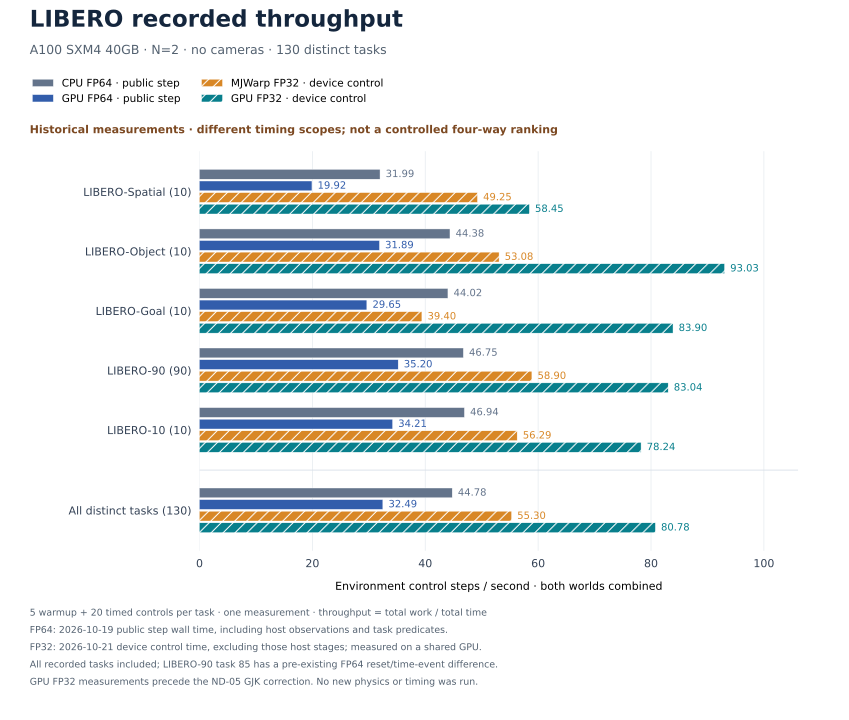

<div align="center">

# GPU-LIBERO

### GPU Simulation for Lifelong Robot Learning

[LIBERO](https://github.com/Lifelong-Robot-Learning/LIBERO) · [Project Website](https://libero-project.github.io/) · [LIBERO Paper](https://arxiv.org/abs/2306.03310) · [LIBERO Documentation](https://lifelong-robot-learning.github.io/LIBERO/)

</div>

**Default batch backend: independent CUDA FP32, with no Warp dependency.**
Native CUDA FP64 and the original MJWarp FP32 reference remain available.
See [recorded throughput](#performance) for four-backend results and timing scopes.

**GPU-LIBERO** adds GPU physics to [LIBERO](https://github.com/Lifelong-Robot-Learning/LIBERO), a benchmark for knowledge transfer in multitask and lifelong robot learning. Install this distribution and keep your existing LIBERO environment code: simulation uses the GPU by default.

- Original LIBERO imports, task definitions, environment interfaces, and benchmark suites.
- 130 manipulation tasks across **LIBERO-Spatial**, **LIBERO-Object**, **LIBERO-Goal**, and **LIBERO-100**, including the **LIBERO-90 / LIBERO-10** split.
- Native FP64 CUDA physics with cuBLASDx / cuSOLVERDx, and independent CUDA FP32 physics following MJWarp algorithms.
- Existing observation, rendering, controller, state, and vector-environment interfaces.
- LIBERO policy architectures, lifelong learning methods, and dataset tools.

The [independent CUDA FP32 backend](libero/libero/gpu/host/backends/cuda_fp32/README.md)
owns model preprocessing, device memory, Graphs, physics scheduling, OSC transport
and observations without installing Warp or MJWarp. It shares the maintained
handwritten CUDA mathematics with the MJWarp migration path. Its isolated
environment uses CPU MuJoCo 3.16.0 for model compilation and OpenGL rendering;
native FP64 uses MuJoCo 2.3.7. The explicit
[MJWarp reference backend](libero/libero/gpu/host/backends/mjwarp/README.md)
remains available. **FP32 is the default precision.** Select `precision="fp64"`
explicitly for native FP64. The performance table below describes the recorded
CPU FP64, native GPU FP64, original MJWarp and independent GPU FP32 paths.
For `GpuBatchEnv`, automatic routing selects independent CUDA for FP32 and
native CUDA for FP64. Use `physics_engine="mjwarp"` for the optional reference.
The [FP32 qualification report](libero/libero/gpu/host/backends/cuda_fp32/QUALIFICATION.md)
records 130-task execution, 127/130 upstream trajectory checks, retained
exceptions and recorded device throughput on a shared GPU. Its measurement
scope differs from the FP64/CPU public-step measurements.
Those full-suite numbers precede the subsequent ND-05 GJK correction; the report
separately records its targeted geometry and three-task correctness follow-up.

## Contents

- [Performance](#performance)
- [FP32 numerical corrections and scope](#fp32-numerical-corrections-and-scope)
- [Installation](#installation)
- [Getting Started](#getting-started)
- [Datasets](#datasets)
- [Training](#training)
- [Evaluation](#evaluation)
- [Configuration](#configuration)
- [Tests](#tests)
- [Contributing](#contributing)
- [Acknowledgments](#acknowledgments)
- [License](#license)

## Performance

Saved measurements on an **NVIDIA A100 SXM4 40GB**, **N=2**, **no cameras**:
each task uses five warmup control steps followed by 20 continuously timed
control steps, measured once. Values below are **environment control steps per
second, summed over both worlds**. Higher values mean greater throughput.

**The two campaigns use different timing scopes and GPU load. These are
historical observations, not a controlled four-backend ranking.**



| Task suite | Tasks | CPU FP64 | GPU FP64 | MJWarp FP32 | GPU FP32 |
| --- | ---: | ---: | ---: | ---: | ---: |
| LIBERO-Spatial | 10 | 31.99 | 19.92 | 49.25 | 58.45 |
| LIBERO-Object | 10 | 44.38 | 31.89 | 53.08 | 93.03 |
| LIBERO-Goal | 10 | 44.02 | 29.65 | 39.40 | 83.90 |
| LIBERO-90 | 90 | 46.75 | 35.20 | 58.90 | 83.04 |
| LIBERO-10 | 10 | 46.94 | 34.21 | 56.29 | 78.24 |
| All distinct tasks | 130 | 44.78 | 32.49 | 55.30 | 80.78 |

| Paths | Date | Measured interval | GPU competition |
| --- | --- | --- | --- |
| CPU FP64 / GPU FP64 | 2026-10-19 | Public `step()` wall time, including control, physics, observations and host task predicates | Original campaign records no competing GPU samples |
| Original MJWarp FP32 / independent GPU FP32 | 2026-10-21 | CUDA-event device control intervals, including action upload, physics, OSC and GPU observations; excludes host observation packaging and predicates | Other GPU work resident; per-task load samples retained |

CPU uses MuJoCo 2.3.7, two `SubprocVectorEnv` workers on distinct physical cores,
and one BLAS thread per worker. GPU FP64 uses the native single-physical-substep
fusion and outer control Graph. Original MJWarp means pinned upstream physics
with the project's shared OSC/observation integration, without the migrated CUDA
physics replacements. GPU FP32 is the independent Warp-free CUDA owner.

Suite throughput is `sum(worlds * timed_control_steps) / sum(elapsed_seconds)`,
not an arithmetic mean of per-task rates. Each control contains 25 physical
substeps; the reported throughput is not multiplied by 25. Creation, reset,
Graph preparation, compilation and rendering are excluded from both campaigns.
Runtime compilation was disabled. The saved FP64 build used Release
`-O3 -DNDEBUG` with `FLASH_FAST_COMPILE=ON`; detailed provenance is linked below.

All 130 recorded tasks are included. LIBERO-90 task 85 has a pre-existing FP64
CPU/GPU reset/time-event difference, retained in the per-task CSV flag.
LIBERO-100 is the union of LIBERO-90 and LIBERO-10, not another 100 measurements.
**FP32 timing predates the ND-05 GJK correction.** Subsequent local geometry and
three-task correctness checks did not repeat the full-suite timings. No new
physics or performance run was performed to assemble this figure. The chart also
predates the subsequent world-local FP32 fusion. That work uses
[regional endpoint checks and local timings](libero/libero/gpu/host/backends/cuda_fp32/README.md#supported-scope-and-validation);
it does not provide a new full-suite throughput result.

[Per-task CSV](media/benchmarks/task-throughput.csv) ·
[Aggregate CSV](media/benchmarks/suite-throughput.csv) ·
[Measurement provenance and original input hashes](media/benchmarks/provenance.json).
Regenerate the CSV aggregate and SVG with `python tools/plot_suite_throughput.py`.

## FP32 numerical corrections and scope

The independent FP32 implementation follows MJWarp commit
`c384ac51df67eb92ab7657cc472ff7494dc036bf` (MuJoCo 3.16.0, Warp 1.18.0 as the
reference). Its CUDA mathematics, device memory, Graphs, model preprocessing,
controller transport and observations execute without installing either Warp
package. The `mjwarp` prefix in shared CUDA filenames records algorithm
provenance; it is not a runtime dependency.

We intentionally retain these corrections beyond a literal port:

| ID | Correction | Scope / purpose |
| --- | --- | --- |
| ND-01 | Translate triangle determinants and affine-weight expressions to edge vectors | Reduce cancellation while preserving the real-arithmetic formula |
| ND-02 | Match zero-direction BOX support points to their corner feature IDs | Keep the support point and recovered feature consistent |
| ND-03 | Refine inconclusive GJK results and attempt EPA only with a certified enclosing hull | Avoid treating a positive simplex-distance upper bound as proof of separation in the qualified zero-margin BOX/BOX domain |
| ND-04 | Retain nondegenerate shallow EPA faces when the complete initial hull encloses the origin | Avoid discarding valid shallow contacts solely because squared face distance is below `1e-10` |
| ND-05 | Verify tuned GJK cutoff exits in the direction actually used for the support query | Repair an inherited invalid separating-plane certificate |

The [numerical-deviation register](libero/libero/gpu/host/backends/mjwarp/NUMERICAL_DEVIATIONS.md)
records exact domains, source functions, independent CPU/FP64 geometric evidence
and retained limits. ND-04's exceptional hull certificate uses FP64 predicates
on rounded FP32 vertices; state and solver arithmetic remain FP32. No blanket
claim of greater whole-trajectory accuracy is made. These corrections can
change contact sets and trajectories; matching unmodified MJWarp and satisfying
independent geometry are separate checks. Solver stopping rules, warmstart,
physical parameters and trajectory tolerances were not changed by them.

The completed 130-task campaign passes all public observation/predicate
boundaries and the existing upstream trajectory policy in **127/130** tasks.
The retained exceptions are Spatial:5 and LIBERO-90:73/75. The latest ND-05
follow-up still leaves these three outside that original endpoint policy:
Spatial:5 has a substantial impact-phase-sensitive angular-velocity difference,
while the two mugs differ on the order of `1e-4 rad/s`. Local collision and
same-QP checks distinguish these cases; they do not prove every whole
trajectory identical or globally more accurate. The full suite has not been
rerun after ND-05. See the
[qualification report](libero/libero/gpu/host/backends/cuda_fp32/QUALIFICATION.md)
for versioned results, the separate stricter checks and 600-control follow-ups.

The supported shipped domain is rigid LIBERO, dense Newton, elliptic contacts,
Euler, Panda OSC, FORCE/TORQUE sensors and FIXED cameras/lights. Unsupported
features fail explicitly; this backend is not a general replacement for every
MuJoCo model. Original MJWarp remains an explicit reference; native FP64 remains
available through `precision="fp64"` in its separate dependency environment.

## Installation

### Requirements

- Python **3.10 or newer**.
- An NVIDIA GPU, NVIDIA driver, and CUDA Toolkit with `nvcc` available.
- CMake **3.24 or newer**, Ninja, and a C/C++ compiler for native dependencies.
- NVIDIA MathDx. If no installation is configured, the runtime downloads its pinned **25.12.1 CUDA12** package on first use.

The single-substep build's default local MathDx prelink requires **NVCC 13.2 or
newer**. Older toolchains require the explicit whole-program device-LTO build
configuration; see the [GPU build guide](libero/libero/gpu/README.md).

For the default independent CUDA FP32 batch, install from the repository root
in an isolated environment and follow its
[offline preparation guide](libero/libero/gpu/host/backends/cuda_fp32/README.md):

```bash
python -m pip install '.[cuda-fp32]'
python -m libero.gpu.host.backends.cuda_fp32.prepare \
  --build-root /path/to/common-project --tasks all \
  --mathdx-root /path/to/mathdx --jobs 2
```

For native FP64 and the original single-environment API, use a separate
environment:

```bash
python -m venv .venv
source .venv/bin/activate
python -m pip install --upgrade pip
python -m pip install 'cmake>=3.24,<4' ninja
python -m pip install '.[native]'
```

Use `-e` for an editable installation of the chosen extra. The FP32 preparation
command consumes a common CPU scene catalogue; the linked guide includes its
Warp-free catalogue builder for a new project.
The extras select incompatible CPU MuJoCo versions and must not be combined.

This distribution installs the `libero` package. Use an environment containing this installation when running your LIBERO code.

### Task resources

Task BDDL files and scene/object XML definitions are included. Meshes, textures, initial states, and demonstration datasets are stored separately. Existing LIBERO resource configurations continue to work; missing default assets and initial states are fetched into the resource cache.

To prepare assets and initial states before creating an environment:

```bash
python -m libero.libero.resource_cli assets init_states
```

Prepare the complete native FP64 GPU project once before creating native batches:

```bash
python -m libero.gpu.build --precision fp64 --num-envs 8 --jobs 3
```

The build enumerates all 130 shipped tasks, materializes their model and template
instances, and compiles missing CUDA/Warp products into one project. LIBERO-100
reuses the existing 90-task and 10-task sets. Matching products are shared across
tasks. The generated [parameter table](libero/libero/gpu/data/libero_task_parameters.json)
records every task and the 13 distinct Newton dimension pairs.

## Getting Started

### Default FP32 batches

By default, `GpuBatchEnv` selects independent CUDA FP32. Explicit
`precision="fp64"` selects native FP64; `LIBERO_GPU_PRECISION=fp64` can also set
the process policy before import. The independent
`precision="fp32", physics_engine="cuda_fp32"` batch uses the
MJWarp-derived handwritten CUDA algorithms and requires neither Warp package.
The older FP32 implementation sharing native FP64 algorithm sources remains
available through `physics_engine="native"`. Select precision before importing
typed physics modules and prepare products offline. Precision is fixed per
process; products can coexist in the same CMake build. See the
[precision guide](libero/libero/gpu/PRECISION.md) for selection, storage,
validation and current scope. The benchmark results above remain FP64.

Use `GpuBatchEnv` to advance multiple worlds of **one task and one shared static
model** in a GPU batch. This is separate from the compatible
`DummyVectorEnv` / `SubprocVectorEnv` interfaces.

```python
import numpy as np
from libero.libero import benchmark
from libero.libero.envs import GpuBatchEnv

suite = benchmark.get_benchmark("libero_10")()
with GpuBatchEnv(
    suite.get_task_bddl_file_path(0),
    num_envs=8,
    init_states=suite.get_task_init_states(0),
    seed=0,
    use_camera_obs=False,
) as env:
    obs = env.reset()
    obs, rewards, successes, infos = env.step(np.zeros((8, env.action_dim)))
    env.reset(id=[0, 3])
    print(env.diagnostics())
```

Observations are dictionaries with a leading environment axis. `step` advances
all worlds; `reset` and `set_init_state` accept selected IDs in caller order.
There is no automatic reset. `set_init_state` preserves controller history,
whereas `reset` clears episode/controller/observation state. Fixture poses are
sampled once at construction and shared; reset selects movable/robot states
from the supplied bank. If no bank is supplied, the corresponding official
`.pruned_init` file is loaded. Different fixture layouts or tasks require
separate batches. Model replacement and interactive rendering are not exposed
through this entry. Set `use_camera_obs=True` for offscreen images; image rendering
and task goal evaluation are still performed at the host boundary.
### Original single-environment API

Use the same task and environment imports as upstream LIBERO. No GPU backend argument or factory registration is required.
The following original single-environment example uses the native installation
and explicitly selects FP64 before importing typed physics. For default FP32,
use the batch example below with the independent CUDA installation.

```python
import os

from libero.gpu import precision
precision.select("fp64")

from libero.libero import benchmark, get_libero_path
from libero.libero.envs import OffScreenRenderEnv

benchmark_dict = benchmark.get_benchmark_dict()
task_suite = benchmark_dict["libero_spatial"]()
task_id = 0
task = task_suite.get_task(task_id)

task_bddl_file = os.path.join(
    get_libero_path("bddl_files"), task.problem_folder, task.bddl_file
)
print(task.language)

env = OffScreenRenderEnv(
    bddl_file_name=task_bddl_file,
    camera_heights=128,
    camera_widths=128,
)
try:
    env.seed(0)
    obs = env.reset()
    init_states = task_suite.get_task_init_states(task_id)
    obs = env.set_init_state(init_states[0])

    for _ in range(10):
        obs, reward, done, info = env.step([0.0] * 7)
finally:
    env.close()
```

Available suite names include `libero_spatial`, `libero_object`, `libero_goal`, `libero_90`, and `libero_10`. LIBERO uses sparse task-completion rewards.

### Native FP64 implementation details

The following options and implementation details apply to explicit native
FP64 batches (`precision="fp64"`) and the legacy native FP32 comparison path.
Default independent FP32 has its own
[configuration and preparation guide](libero/libero/gpu/host/backends/cuda_fp32/README.md).

Native batches retain the low-level physics factory's diagnostic construction mode.
Full-capacity Newton input snapshots (`entry_witness`) are disabled by default:
normal execution allocates no witness buffers and launches no witness copies.
`GpuBatchEnv(..., debug=False)` also disables recovery event recording and the
diagnostic prefix comparisons and cache snapshots. The immutable-model fast path
retains its qualified epoch-based position reuse. It captures
one complete control step when needed and replays that CUDA graph, avoiding
Python source/binding validation on every physical substep. Host boundary status
packets and per-step numerical verification are disabled. `debug=True` enables
these diagnostics and uses the original Python substep path. Cold construction
validation and the physical solver's control flow, convergence and warning/reset
behavior still apply. The dedicated quality recorder also enables input snapshots.
In the default fast profile, collision processing also skips inactive-output
backup copies and computes contact parameters only for live queries and kept
contacts. `debug=True` retains the full-capacity collision diagnostics. Contact
ordering, configured capacities and overflow/error handling are unchanged.
Set `strict_build_receipts=True` to additionally use the product entry's full
compiler/library dependency receipts and artifact cache; this can add substantial
cold-build time. This option does not change `debug` or grant numerical qualification.

For source ownership, ordinary versus explicitly fused graphs, and retained
fallback paths, see the [runtime architecture index](libero/libero/gpu/ARCHITECTURE.md).
For N=2 endpoint checks and single-measurement CPU/GPU comparisons, use the
[stable validation tools](tools/validation/README.md). Historical experiment
drivers and their evidence belong in the external development workspace.

Native batch execution loads a completed offline build, by default from
`~/.cache/libero-gpu/project` (or `$LIBERO_GPU_CACHE_DIR/project`). Set `build_root`
to choose another directory, using the same value for `libero.gpu.build`.

The original `OffScreenRenderEnv` entry uses signed native products. Its offline
compatibility profile is prepared separately from the default batch catalogue:

```bash
LIBERO_GPU_PRECISION=fp64 python -m libero.gpu.build --compatibility \
  --precision fp64 --suite libero_10 --task-ids 4
```

This prepares the selected tasks without cameras and advances one control step
to load lazy modules. It shares the project's constraint sources and Warp cache,
with separate runtime owners for mutable buffers and parameters. Ordinary compatibility
construction and subsequent step/reset/observation/render calls are load-only
and report a preparation command when a signed product is missing. Explicit
offline compilation authority applies only while its scope is active; it does
not grant the constructed environment permanent permission to compile. An
existing unsigned batch build is not a signed receipt;
source or profile changes can require new offline products. Other tasks or
camera configurations require their corresponding offline preparation.
Offline preparation requires every signed product to be persisted. A full
signed cache raises `ENOSPC`; `compatibility/BUILD.json` records `preparing`,
`failed`, or `complete`, and cannot report a private, unpersisted build as ready.

FP32 training reads fixed offline scenes and CUDA products. Creating, resetting
and closing an environment does not register scenes, update an LRU or maintain
disk-cache metadata. Scene preparation takes an offline writer lock; cleanup of
prepared inputs is a separate maintenance operation outside training.
Native compatibility environments also keep model intake and replacement in
memory. Stateless native code loads from fixed signed products; the few loaders
that still need private files use an environment-owned temporary directory,
removed after a successful close. Runtime construction does not maintain a
storage catalog, model-file leases, or LRU budgets. See
[environment and offline cache lifecycle](libero/libero/gpu/ENVIRONMENT_LIFECYCLE.md)
for configuration and inspection. Historical caches and the offline compiler
project are retained separately; environment close does not delete them.
Prepared native scene models and generated constraint/Newton sources are loaded
from the instance catalog. Runtime buffers, graphs and owner bindings are created
for each environment. Missing native or Warp products raise an error before
compilation; normal batch execution does not run NVCC or NVRTC builds.
Changes to source or the requested build profile require an offline build.
`allow_compile=True` is an explicit developer option used by the offline builder.
The default profile uses Panda/OSC_POSE, seed 0, N=8 and the standard camera setup.

Device memory is budgeted from the selected GPU's **current free memory** during
construction, after existing physics allocations. The planner reserves an
estimate for subsequent solver/controller/observation allocations plus the
larger of 512 MiB or 10% of the available budget as headroom. An optional `memory_budget`
dictionary accepts `limit_bytes`, `reserve_bytes`, and `safety_fraction`; the
limit applies to allocations remaining at the planning boundary. The snapshot
is available in `env.memory_budget`. These are estimates, so subsequent CUDA
allocation failures remain possible. Index, model, contact, and kernel resource
checks remain enforced. Insufficient memory raises an error without changing N
or truncating contacts.

After the unified build, verify a prepared task without resetting or advancing it:

```bash
python -m benchmark_scripts.benchmark_gpu_batch --suite libero_10 --num-envs 8 --task-ids 0 --build-only --output results/build.json
```

The report records the project directory and actual compiler calls. This
mode still creates CUDA owners and records graphs, but executes no control steps.
`GpuBatchEnv(..., initialize=False)` provides the same preparation boundary;
call `reset()` before stepping it.

To time the complete batch interface, excluding setup, reset, and policy inference:

```bash
python -m benchmark_scripts.benchmark_gpu_batch --suite libero_10 --num-envs 8 --warmup 20 --steps 600 --repeats 1
# Add --camera for two 128x128 RGB cameras, or --task-ids 0 for one task.
```

Use the same `--build-root` for preparation and timing if specifying one.
The JSON report includes the build cache and compiler calls, setup time, milliseconds per batch control
step, environment steps per second, actual integration counts, and the budget
snapshot. These measurements include host goal/observation work and are not
device-only kernel timings. Tasks rejected by the memory preflight are recorded
with `status="insufficient_memory"`; the runner continues with the other tasks
at the requested N.

For task generation and benchmark usage, see the [upstream documentation](https://lifelong-robot-learning.github.io/LIBERO/).

## Datasets

Download the original human demonstration datasets:

```bash
python benchmark_scripts/download_libero_datasets.py --use-huggingface
```

To download a single suite:

```bash
python benchmark_scripts/download_libero_datasets.py \
    --datasets libero_spatial --use-huggingface
```

Dataset choices are `libero_spatial`, `libero_object`, `libero_goal`, and `libero_100`. The download location follows your LIBERO dataset configuration. Datasets are also available on [Hugging Face](https://huggingface.co/datasets/yifengzhu-hf/LIBERO-datasets).

## Training

The original LIBERO training interface is retained. For example:

```bash
export CUDA_VISIBLE_DEVICES=0
export MUJOCO_EGL_DEVICE_ID=0
python -m libero.lifelong.main \
    seed=0 \
    benchmark_name=LIBERO_SPATIAL \
    policy=bc_transformer_policy \
    lifelong=base
```

Choose a benchmark from `LIBERO_SPATIAL`, `LIBERO_OBJECT`, `LIBERO_GOAL`, `LIBERO_90`, or `LIBERO_10`; a policy from `bc_rnn_policy`, `bc_transformer_policy`, or `bc_vilt_policy`; and a method from `base`, `er`, `ewc`, `packnet`, or `multitask`.

## Evaluation

Evaluate a saved checkpoint using the original evaluation command:

```bash
python -m libero.lifelong.evaluate \
    --benchmark libero_spatial \
    --task_id 0 \
    --algo base \
    --policy bc_transformer_policy \
    --seed 0 \
    --ep 50 \
    --load_task 0 \
    --device_id 0
```

Set the suite, task, seed, epoch, and training-task index to match your checkpoint. Use `--experiment_dir` to select its experiment directory.

## Configuration

| Variable | Purpose |
| --- | --- |
| `LIBERO_CONFIG_PATH` | Directory containing your LIBERO resource-path configuration. |
| `LIBERO_RESOURCE_PATH` | Cache location for automatically fetched task assets and initial states. |
| `LIBERO_GPU_CACHE_DIR` | GPU build and runtime cache directory. |
| `LIBERO_NVCC` | Path to the CUDA compiler. |
| `LIBERO_MATHDX_ROOT` | MathDx installation root containing `include/`, `external/cutlass/include/`, and `lib/libcusolverdx.a`. |

For CUDA source layout and low-level entry points, see [GPU source documentation](libero/libero/gpu/README.md).

## Tests

A small regression suite covers installation layout, resource and toolchain paths, source dependencies, vector protocols, and observation/graphics ownership. See [tests/README.md](tests/README.md) for commands and scope.

## Contributing

Development and releases use this Git repository. See [CONTRIBUTING.md](CONTRIBUTING.md) for editable installation, focused branches, CPU checks, and tagged releases. The release tool builds checked wheel/source artifacts directly from the current working tree.

## Acknowledgments

This project builds on [LIBERO](https://github.com/Lifelong-Robot-Learning/LIBERO), developed by the Lifelong Robot Learning team. We thank the LIBERO authors and the developers of MuJoCo, libccd, robosuite, NVIDIA Warp, and NVIDIA MathDx for their work.

## License

Project-original GPU-LIBERO contributions are licensed under the **MIT License**, with copyright attributed to the GPU-LIBERO contributors. See the root [LICENSE](LICENSE) for the project license and component scope.

Upstream LIBERO-derived code retains its original [MIT license and copyright notice](licenses/LIBERO-MIT.txt). Adapted MuJoCo code retains **Apache-2.0**, and libccd code retains **BSD-3-Clause**. These third-party terms are preserved and are not replaced by the project MIT license.

See [Third-Party Notices](libero/libero/gpu/THIRD_PARTY_NOTICES.md) for source attribution and license texts. External SDKs and dependencies, including NVIDIA MathDx, retain their own licenses.
